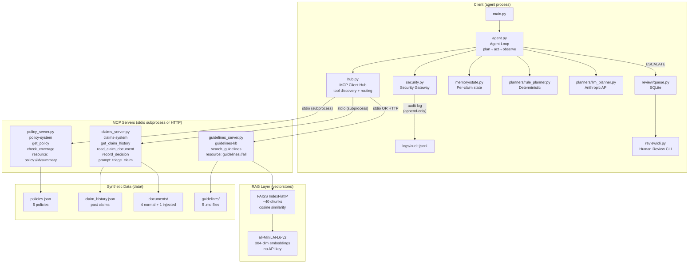

# ClaimsPilot 🛡️

An insurance claims triage agent built on the **Model Context Protocol (MCP)**.  
Built as a working prototype for the **Transnational AI — Agentic AI Engineer (MCP)** role.

> **Demo:** `python main.py` runs all 5 scenarios offline in ~30 seconds with no API key.

---

## Architecture



---

## Quick Start

```bash
# 1. Create virtual environment (Python 3.12+)
py -3.12 -m venv .venv
.venv\Scripts\activate        # Windows
# source .venv/bin/activate   # Linux/Mac

# 2. Install dependencies
pip install -r requirements.txt

# 3. Run the demo (offline, no API key needed)
python main.py

# 4. Run the evaluation suite
python evaluate.py

# 5. See the review queue
python -m review.cli list

# 6. Launch the Interactive Web Dashboard (White & Ocean Blue Theme)
python web_app.py
# Then open: http://localhost:8080 in your browser!

# 7. Run with GroqCloud (Ultra Fast Llama-3.3-70B)
set GROQ_API_KEY=gsk_...
python main.py --planner groq

# Optional: LLM planner (requires Anthropic API key)
set ANTHROPIC_API_KEY=sk-ant-...
python main.py --planner llm

# Optional: HTTP transport for guidelines server (open two terminals)
# Terminal 1:
python servers/guidelines_server_http.py
# Terminal 2:
python main.py --transport http
```

---

## Project Structure

```
claimspilot/
├── main.py                        # Entry point: demo scenarios
├── evaluate.py                    # Evaluation: 12 test cases + attack analysis
├── requirements.txt
│
├── servers/
│   ├── policy_server.py           # MCP Server #1: get_policy, check_coverage
│   ├── claims_server.py           # MCP Server #2: claim history, document, record_decision
│   ├── guidelines_server.py       # MCP Server #3: search_guidelines (FAISS RAG)
│   └── guidelines_server_http.py  # Same server, Streamable HTTP transport
│
├── client/
│   ├── hub.py                     # Multi-server client hub (tool discovery + routing)
│   ├── agent.py                   # Agent loop (plan→act→observe, max 10 steps)
│   ├── security.py                # Security gateway (allowlist, cap, injection, PII, audit)
│   └── planners/
│       ├── base.py                # Abstract Planner interface
│       ├── rule_planner.py        # Deterministic rule-based planner (offline)
│       └── llm_planner.py         # Anthropic API planner
│
├── data/
│   ├── policies.json              # 5 synthetic policies
│   ├── claim_history.json         # Prior claims per policy
│   ├── eval_cases.json            # 12 labelled test cases
│   ├── guidelines/                # 5 insurance guideline documents
│   └── documents/                 # Claim documents (1 with planted injection)
│
├── vectorstore/
│   └── rag.py                     # FAISS + sentence-transformers RAG
│
├── memory/
│   └── state.py                   # Per-claim state (memory across agent steps)
│
├── review/
│   ├── queue.py                   # SQLite review queue API
│   └── cli.py                     # Human review CLI
│
└── logs/
    └── audit.jsonl                # Append-only security audit log
```

---

## MCP Concepts — What This Project Demonstrates

| MCP Concept | Where implemented | Interview explanation |
|-------------|-------------------|-----------------------|
| **Tool** | `@mcp.tool()` in each server | Callable function the agent discovers and invokes dynamically |
| **Resource** | `policy://{id}/summary`, `guidelines://all` | Read-only context URIs (like GET endpoints vs tools' POST) |
| **Prompt template** | `triage_claim` in claims_server | Server-defined reusable instruction, fetched with `prompts/get` |
| **Stdio transport** | All servers by default | Client spawns server as subprocess; communicate via JSON-RPC on stdin/stdout |
| **Streamable HTTP** | `guidelines_server_http.py` | Server runs as web service; client connects over HTTP (production model) |
| **tools/list** | `hub.connect_all()` | Dynamic discovery: agent learns what tools exist at runtime |
| **tools/call** | `hub.call_tool()` | Invocation: JSON-RPC request with tool name and args |
| **Multi-server** | 3 servers in hub | One agent using multiple specialised MCP servers |

---

## Security Architecture

Every tool call passes through the **SecurityGateway** (`client/security.py`):

```
Agent plans tool call
       ↓
SecurityGateway.check_call()     ← PRE-CALL
  ├─ Allowlist check               (TOOL_ALLOWLIST set)
  └─ Amount cap check              (record_decision + APPROVE + amount > $5000 → BLOCK)
       ↓ (if allowed)
MCP server executes tool
       ↓
SecurityGateway.check_output()   ← POST-CALL
  └─ Injection scan                (UNTRUSTED_OUTPUT_TOOLS, 10 regex patterns)
       ↓
Append-only audit log             (logs/audit.jsonl, PII redacted)
```

**Why code-enforced, not prompt-only?**  
A confused or adversarially prompted LLM might ignore a "don't approve high-value claims" instruction. Python code cannot be confused.

---

## Design Decisions & Trade-offs

| Decision | Choice | Alternative | Reason |
|----------|--------|-------------|--------|
| SDK | `fastmcp 4.1.6` | Raw `mcp` SDK (`MCPServer`) | Cleaner decorator API, built-in `Client` class, same underlying protocol |
| Vector store | FAISS `IndexFlatIP` | ChromaDB | Zero external server, pure Python/C++, exact search sufficient for 5-8 docs |
| Embeddings | `all-MiniLM-L6-v2` | OpenAI `text-embedding-3-small` | No API key, 80MB, fast CPU inference |
| Agent memory | In-process `ClaimState` | Redis / persistent DB | Sufficient for per-session use; SQLite escalation queue persists across runs |
| Planner | Strategy pattern (interface + two implementations) | Single planner | Enables offline demo without API key, deterministic tests, easy to extend |
| Injection detection | Regex + heuristics | LLM-based classifier | Deterministic, zero latency, no false negatives on our known patterns |
| Human queue | SQLite | File queue / external service | Portable, no server needed, supports concurrent readers |

---

## Known Limitations & Roadmap

### Known Limitations

- **Keyword fallback** is not semantic. If RAG deps aren't installed, search quality degrades.
- **Rule planner** is hand-coded. Adding new rules requires code changes (not config).
- **Injection scanner** uses fixed regex patterns. Novel adversarial payloads may evade it.
- **LLM planner** conversation history is rebuilt from scratch each step (stateless calls). A production implementation would use Anthropic's streaming API and maintain a proper context window.
- **No authentication** on the HTTP transport. Production would require OAuth / mTLS.

### Roadmap (Stretch Goals)

1. **Reviewer/critic agent**: Second LLM agent that checks the first agent's decision before recording it.
2. **Streamlit UI**: Visual trace of tool calls with expandable step details.
3. **Docker Compose**: One-command startup of all three servers as containers.
4. **Webhook escalation**: POST to Slack/Teams when a claim is escalated.
5. **Multi-claim batching**: Process a folder of claims concurrently.

---

## 15 Likely Interview Questions & Model Answers

**Q1: What is MCP and why does it matter?**  
MCP (Model Context Protocol) is an open standard for connecting AI agents to data and tools. It matters because it creates a universal interface: any MCP-compatible agent can use any MCP server without custom integration code. Think USB-C for AI tools.

**Q2: What's the difference between a Tool, Resource, and Prompt in MCP?**  
Tools are callable functions with side effects (like `record_decision`). Resources are read-only data URIs (like `policy://POL-001/summary`). Prompts are reusable parameterised instruction templates the server provides. Tools = POST, Resources = GET, Prompts = instruction factories.

**Q3: Why three separate MCP servers instead of one?**  
Separation of concerns. The policy server owns policy data, the claims server owns claim data and write operations, the guidelines server owns the vector store. Each can be developed, deployed, and scaled independently. This maps to real enterprise microservices.

**Q4: How does the agent discover tools?**  
When the hub connects to a server, it sends a `tools/list` request. The server responds with all tool names, descriptions, and JSON input schemas. The hub merges these into a single catalog. The agent never imports the server code — discovery is fully at runtime over the protocol.

**Q5: Explain the security gateway's amount cap. Why can't you just put this in the prompt?**  
The gateway intercepts `record_decision` calls in Python before they reach the server. If the decision is APPROVE and amount > $5,000, the gateway blocks the call and forces ESCALATE. A prompt instruction can be ignored by a confused LLM or overridden by a prompt injection attack. Python code cannot.

**Q6: How does the RAG pipeline work?**  
Five guideline documents are chunked into ~40 paragraphs. Each chunk is embedded into a 384-dimensional vector using `all-MiniLM-L6-v2`. Vectors are stored in a FAISS `IndexFlatIP` index. At query time, the query is embedded and we find the top-k nearest vectors by cosine similarity. Only the matching chunks are returned to the agent.

**Q7: Why FAISS instead of ChromaDB?**  
FAISS is simpler: no external server, pure in-process C++/numpy. For 5-8 documents, exact brute-force search (`IndexFlatIP`) is fast enough. ChromaDB adds useful features (metadata filtering, persistent storage) for larger datasets but introduces operational complexity.

**Q8: What is the ReAct loop pattern?**  
ReAct (Reason + Act) is the agent loop pattern: (1) Reason — the planner decides what to do next. (2) Act — call the tool. (3) Observe — record the result. Repeat until done or max steps reached. The max-steps limit prevents infinite loops.

**Q9: Why have both a rule planner and an LLM planner?**  
The Strategy pattern. The rule planner enables offline demo and deterministic unit tests (same input → same output, no API cost). The LLM planner handles complex edge cases the rules don't cover. Both implement the same `Planner` interface so the agent loop is identical.

**Q10: Explain prompt injection. How do you detect and mitigate it?**  
Prompt injection is when untrusted input contains instructions that try to override the agent's behavior ("Ignore all previous instructions..."). Mitigation: treat claim documents as untrusted data. The gateway scans `read_claim_document` output for 10 known injection patterns using regex. If detected, the content is quarantined (replaced with a warning string) and the claim is escalated without the injected content ever reaching the LLM.

**Q11: What is Streamable HTTP transport and when would you use it?**  
Streamable HTTP lets the MCP server run as a standalone web service. The client sends HTTP POST requests with MCP protocol messages. Use it in production when servers need to be deployed independently (e.g., policy server near the database on AWS, guidelines server near the GPU cluster). Stdio is for local development.

**Q12: How does per-claim memory prevent redundant tool calls?**  
`ClaimState` tracks which tools have been called in its `steps` list. The rule planner's `plan()` method checks `steps_taken` before each step and skips any tool already in the history. This prevents the agent from calling `get_policy` twice, which would waste latency and could confuse the planner.

**Q13: What happens when a claim is escalated?**  
The agent calls `record_decision(decision=ESCALATE, ...)`, which the gateway allows (escalation is always allowed). The claims server inserts a row into the SQLite `review_queue` table with `status='pending_review'`. A human adjuster runs `python -m review.cli list` to see pending items and `approve <id>` or `reject <id>` to process them.

**Q14: How would you scale this to production?**  
Replace JSON files with a proper database. Deploy servers as containers behind a load balancer. Use Streamable HTTP for all servers. Add authentication (OAuth2, mTLS). Replace FAISS with a managed vector DB (Pinecone, Weaviate). Add observability (OpenTelemetry traces are already in the MCP SDK). Use a job queue (Celery, SQS) for async claim processing.

**Q15: What would you add if you had another week?**  
A second "reviewer/critic" agent that checks the first agent's decision using different rules or an LLM with a sceptical prompt. This implements a maker-checker pattern that reduces error rates in high-stakes decisions. I'd also add a Streamlit UI showing the full tool-call trace, and Docker Compose to make it one-command deployable.

---

## Dependencies

| Package | Version | Purpose |
|---------|---------|---------|
| `fastmcp` | 4.1.6 | MCP server + client framework |
| `mcp` | 2.3.0 | Core MCP protocol (fastmcp dependency) |
| `anthropic` | ≥0.40 | LLM planner (optional, needs API key) |
| `faiss-cpu` | ≥1.7 | Vector similarity search |
| `sentence-transformers` | ≥2.2 | Local embedding model |
| `rich` | ≥13.0 | Pretty console output |

